


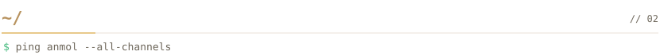

<a href="https://akhouri-anmol-kumar.github.io/Akhouri-systems"></a>
<a href="https://dev.to/akhourianmolkumar"></a>
<a href="https://www.linkedin.com/in/akhourianmolkumar/"></a>
<a href="https://peerlist.io/akhourianmol"></a>
<a href="https://www.instagram.com/aak31_anmol/"></a>

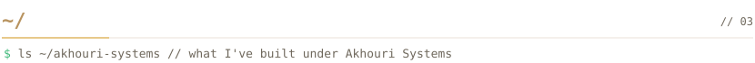

<table>
<tr>
<td align="center">
<a href="https://github.com/Akhouri-Systems/ATLOCK"></a> 

</td>
<td align="center">
<a href="https://github.com/Akhouri-Anmol-Kumar/APIC"></a> 

</td>
</tr>
<tr>
<td align="center" colspan="2">
<a href="https://github.com/Akhouri-Systems/ASNIPP"></a> 

</td>
</tr>
</table>

<b>⌨ ASNIPP hotkeys</b>

 

| Hotkey | Action |
|---|---|
| `Win+Shift+S` / `Ctrl+Shift+S` / `PrintScreen` | Screenshot |
| `Win+Shift+R` | Start / stop screen recording |
| `Ctrl+Alt+D` | Live screen drawing (works while recording) |
| `Ctrl+Alt+P` | Colour picker + pixel ruler |
| `Ctrl+Alt+L` | Capture library |

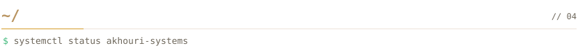


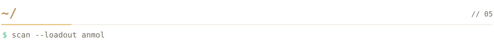



